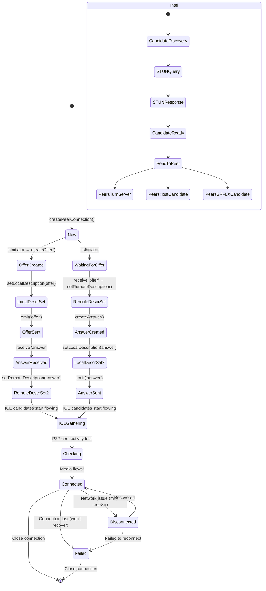
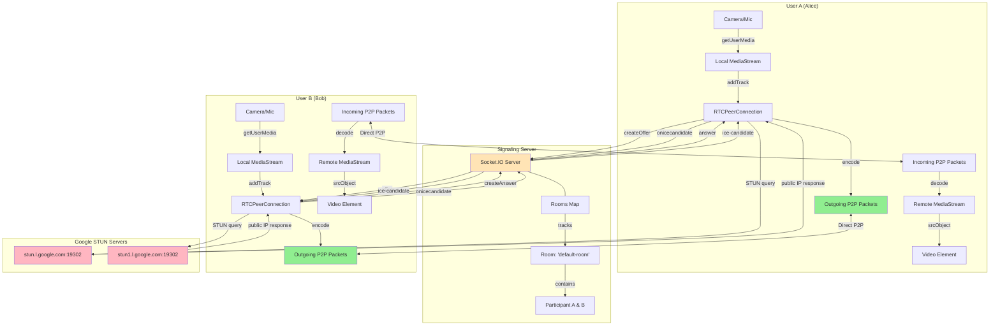

# Complete Connection Flow Diagram

```mermaid
sequenceDiagram
    participant UserA as User A (First)
    participant Server
    participant UserB as User B (Second)
    participant STUN as Google STUN
    
    Note over UserA,STUN: === Phase 1: User A Joins Alone ===
    
    UserA->>UserA: 1. Click "Join Call" button
    UserA->>UserA: 2. Enter name: "Alice"
    UserA->>BrowserAPI: 3. getUserMedia({video:true, audio:true})
    BrowserAPI-->>UserA: 4. MediaStream with tracks
    UserA->>UserA: 5. localVideo.srcObject = localStream
    UserA->>UserA: 6. Show callContainer, hide setupContainer
    UserA->>Server: 7. socket.emit('join-call', 'default-room', 'Alice')
    Server->>Server: 8. Create room 'default-room'
    Server->>Server: 9. room.add({id: socketA.id, name: 'Alice'})
    Server->>UserA: 10. socket.emit('joined-call', [])
    Note over UserA: 11. No peer connections (alone in room)
    
    Note over UserA,STUN: === Phase 2: User B Joins (10 seconds later) ===
    
    UserB->>UserB: 12. Click "Join Call"
    UserB->>UserB: 13. Enter name: "Bob"
    UserB->>BrowserAPI: 14. getUserMedia({video:true, audio:true})
    BrowserAPI-->>UserB: 15. MediaStream with tracks
    UserB->>UserB: 16. localVideo.srcObject = localStream
    UserB->>UserB: 17. Show callContainer, hide setupContainer
    UserB->>Server: 18. socket.emit('join-call', 'default-room', 'Bob')
    Server->>Server: 19. room.add({id: socketB.id, name: 'Bob'})
    Server->>UserB: 20. socket.emit('joined-call', [socketA.id])
    Server->>UserA: 21. socket.emit('user-joined', socketB.id, 'Bob')
    
    Note over UserA,STUN: === Phase 3: WebRTC Handshake - User B initiates ===
    
    UserB->>UserB: 22. socket.on('joined-call') triggered
    UserB->>UserB: 23. createPeerConnection(socketA.id, isInitiator=true)
    UserB->>UserB: 24. Create RTCPeerConnection with STUN servers
    Note over UserA,STUN: 24a. Config: iceServers: ['stun:stun.l.google.com:19302']
    UserB->>UserB: 25. remoteVideoElement = create video element
    UserB->>UserB: 26. peers.set(socketA.id, {connection, videoElement})
    UserB->>UserB: 27. Add local tracks: localStream.getTracks()
    UserB->>UserB: 28. peerConnection.addTrack(track, localStream)
    UserB->>UserB: 29. Set event handlers (ontrack, onicecandidate, etc)
    UserB->>UserB: 30. if (isInitiator) {
    UserB->>UserB: 31.   offer = await createOffer()
    UserB->>UserB: 32.   setLocalDescription(offer)
    UserB->>Server: 33. socket.emit('offer', socketA.id, offer)
    Note over UserA,UserB: SDP: Contains codecs, formats, transport info
    
    UserB->>STUN: 34a. onicecandidate(event)
    STUN-->>UserB: 34b. STUN response with public IP
    UserB->>Server: 35. socket.emit('ice-candidate', socketA.id, candidate)
    Note over UserA,UserB: Candidate: "192.168.1.x:54321" or public IP
    
    Note over UserA,STUN: === Phase 4: User A receives User B ===
    
    UserA->>UserA: 36. socket.on('user-joined') triggered
    UserA->>UserA: 37. createPeerConnection(socketB.id, isInitiator=false)
    UserA->>UserA: 38. Create RTCPeerConnection with STUN servers
    UserA->>UserA: 39. remoteVideoElement = create video element
    UserA->>UserA: 40. peers.set(socketB.id, {connection, videoElement})
    UserA->>UserA: 41. Add local tracks: localStream.getTracks()
    UserA->>UserA: 42. peerConnection.addTrack(track, localStream)
    UserA->>UserA: 43. Set event handlers (ontrack, onicecandidate, etc)
    Note over UserA: No createOffer() - waiting as responder
    
    UserA->>STUN: 44. onicecandidate will fire later
    
    Note over UserA,STUN: === Phase 5: Answer Flow - User A responds ===
    
    UserA->>Server: 45. socket.on('offer', fromId=socketB, offer)
    UserA->>UserA: 46. peer = peers.get(socketB.id)
    UserA->>UserA: 47. peer.connection.setRemoteDescription(offer)
    UserA->>UserA: 48. answer = await createAnswer()
    UserA->>UserA: 49. setLocalDescription(answer)
    UserA->>Server: 50. socket.emit('answer', socketB.id, answer)
    
    UserA->>STUN: 51a. onicecandidate(event) triggered
    STUN-->>UserA: 51b. STUN response with public IP
    UserA->>Server: 52. socket.emit('ice-candidate', socketB.id, candidate)
    
    Note over UserA,STUN: === Phase 6: Connection Established ===
    
    UserB->>Server: 53. socket.on('answer', fromId=socketA, answer)
    UserB->>UserB: 54. peer = peers.get(socketA.id)
    UserB->>UserB: 55. peer.connection.setRemoteDescription(answer)
    
    Note over UserA,UserB: SDP negotiation complete!
    
    UserA->>UserB: 56. Direct P2P connection attempts begin
    UserB->>UserA: 57. ICE candidates exchanged (Steps 35, 52)
    
    UserA->>UserB: 58. Media packets flow (audio/video)
    UserB->>UserA: 59. Media packets flow (audio/video)
    
    UserA->>UserA: 60. ontrack event fires (remote stream received)
    UserA->>UserA: 61. peer.videoElement.srcObject = event.streams[0]
    UserA->>UserA: 62. Remote video starts playing!
    
    UserB->>UserB: 63. ontrack event fires (remote stream received)
    UserB->>UserB: 64. peer.videoElement.srcObject = event.streams[0]
    UserB->>UserB: 65. Remote video starts playing!
    
    Note over UserA,STUN: === Connection Complete! ===
    
    UserA->>UserA: State: iceConnectionState = 'connected'
    UserB->>UserB: State: iceConnectionState = 'connected'
    
    Note over UserA,STUN: Key Points: <br/>- Steps 34-35 & 51-52 happen concurrently and continuously <br/>- ontrack fires when first media packets arrive <br/>- All steps occur within ~2 seconds <br/>- Direct P2P media flow (no server involvement)
```



## Detailed Connection States



## Data Flow Diagram



## Timeline View (approximate)

```mermaid
gantt
    title Connection Flow Timeline (0-5 seconds)
    dateFormat ss
    axisFormat %S
    
    section User A
    Joins room         :a1, 00, 1s
    Waits alone        :a2, after a1, 9s
    Receives join      :a3, after a2, 0s
    Creates peer       :a4, after a3, 0.3s
    Receives offer     :a5, after a4, 0.5s
    Creates answer     :a6, after a5, 0.3s
    Sends answer       :a7, after a6, 0.1s
    Receives media     :a8, after a7, 1s
    
    section User B
    Joins room         :b1, 10s, 0.5s
    Gets user list     :b2, after b1, 0s
    Creates peer       :b3, after b2, 0.2s
    Creates offer      :b4, after b3, 0.3s
    Sends offer        :b5, after b4, 0.1s
    Receives answer    :b6, after b5, 0.8s
    Receives media     :b7, after b6, 1s
    
    section Server
    User A joins       :s1, 00, 0.2s
    Process B join     :s2, 10s, 0.1s
    Relay offer        :s3, after b5, 0s
    Relay answer       :s4, after a7, 0.1s
    ICE forwarding     :s5, after b5, 10s
    
    section ICE/Candidates
    B ICE start        :i1, after b4, 0s
    A ICE start        :i2, after a6, 0s
    STUN queries       :i3, 10.5s, 0.5s
    Candidate exchange:i4, after i3, 1s
    P2P connected      :i5, after i4, 1s
```

## Connection Parameters

| Component | Detail |
|-----------|--------|
| **Media** | Video: true, Audio: true |
| **Codec** | VP8/H.264 (browser-negotiated) |
| **ICE Servers** | stun.l.google.com:19302, stun1.l.google.com:19302 |
| **Network** | Full mesh topology |
| **Protocol** | ICE/STUN over UDP/TCP |
| **Transport** | SRTP (Secure Real-time Transport Protocol) |
| **Bandwidth** | ~400-1200 Kbps per stream |

## Event Summary

**Socket Events:**
- `join-call`: Join a room with name
- `joined-call`: Response with participant list
- `user-joined`: Someone else joined
- `user-left`: Someone disconnected
- `offer`: WebRTC offer SDP
- `answer`: WebRTC answer SDP
- `ice-candidate`: ICE candidate for NAT traversal

**WebRTC Events:**
- `ontrack`: Remote media received
- `onicecandidate`: ICE candidate discovered
- `oniceconnectionstatechange`: Connection state change
- Signaling state: `stable`, `have-local-offer`, `have-remote-offer`

**Connection States:**
- `new` -> `connecting` -> `connected` -> `disconnected`/`failed` -> `closed`
